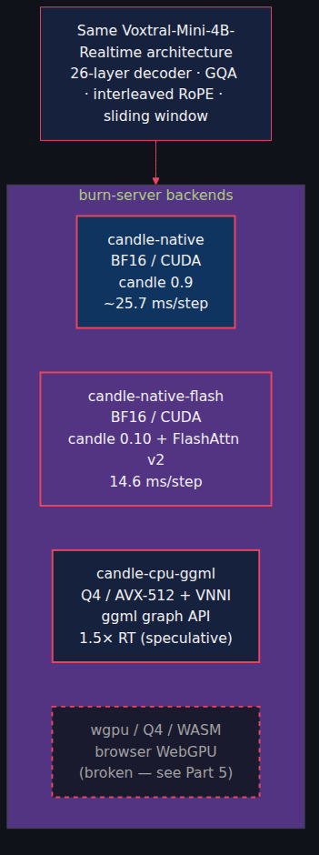
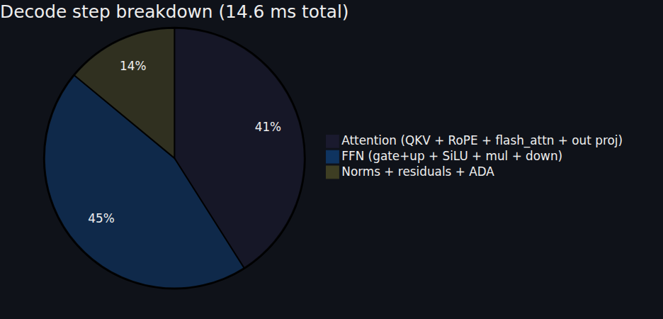
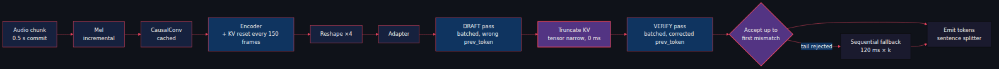
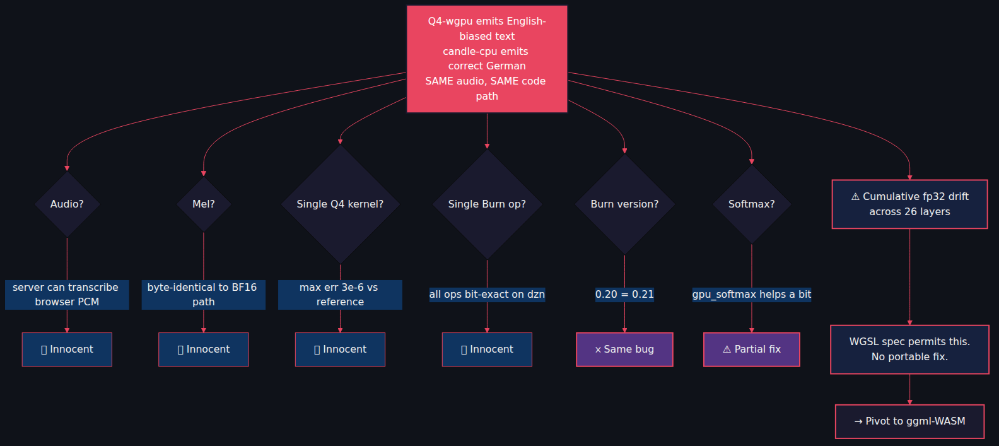

# Voxtral on Rust: Three GPU Backends, a CPU Streaming Engine, and One Spectacular WebGPU Dead End

*Part 2 of the Starling series. Same model as Post 1, same UI, none of the Python. Plus FlashAttention v2 on the GPU, speculative decoding on a laptop, and five months of WGSL spec footnotes.*

---

[Post 1](https://github.com/gjovanov/starling/blob/master/docs/blog/voxtral-asr-vllm/blog-post-medium.md) showed Voxtral-Mini-4B running on Python + vLLM. `burn-server` is the same model, the same frontend, the same realtime captions — implemented in pure Rust with [candle](https://github.com/huggingface/candle) and [burn](https://github.com/tracel-ai/burn). One process owns the GPU directly. No vLLM, no torch, no FastAPI-spawning-a-subprocess.

This post tours four backends, ends at a five-month bisection that I'd like to save you from repeating.

▶️ **Demo video** (90 s, same Salzburg news, Rust backend): <!-- TODO: YouTube URL -->

The MP4 is also committed at `docs/blog/voxtral-asr-burn/video.mp4`.

---

## Four backends, one model

Same Mel spectrogram. Same audio padding. Same streaming engine. The only thing that changes is the matmul provider underneath.

## candle-native (BF16 CUDA, the reference)

Pure candle 0.9, BF16 weights, CUDA cuBLAS. The goal was to produce *identical* output to [voxtral.c](https://github.com/antirez/voxtral.c) on the same audio. A few non-obvious details:

- **Interleaved RoPE** (GPT-J style), not split-half NeoX. Copy a generic transformer's RoPE and you get *nearly correct* German transcription as English. Diabolical.
- **Silence padding**: 32 left + 17 right mel frames. The CausalConv needs both.
- **Streaming prefix**: BOS + 38 STREAMING_PAD tokens.
- **8-frame boundary margin** at the conv edge — last 8 frames are provisional until the next commit arrives.

End-to-end: ~25.7 ms/decode step, ~3× realtime on an RTX 5090.

## candle-native-flash (BF16 CUDA, 1.76× faster)

candle 0.10 ships three fused kernels we use:

- `candle_nn::ops::rms_norm` — 1 kernel replaces 7 ops, × 53 calls/step.
- `candle_nn::rotary_emb::rope_i` — 1 kernel replaces ~36 ops, × 26 calls/step.
- `flash_attn_varlen` decode — avoids the KV-cache contiguous copy.

Plus small wins: pre-cast BF16 RoPE tables, GPU argmax (1 u32 transfer vs 131K floats), zero-copy RoPE reshape at seq=1, disabled CUDA event tracking.

**Result: 14.6 ms/decode step. 1.76× faster than 0.9.**

~74% of the step is candle's per-op dispatch overhead. ~26% is actual GPU compute, bandwidth-limited. Future wins require fewer ops, not faster ops.

## candle-cpu-ggml (Q4 on a laptop, streaming)

CPU inference for a 4B-param ASR model sounds absurd until you remember [ggml](https://github.com/ggerganov/ggml) has spent two years making AVX-512+VNNI Q4 matmul go ridiculously fast.

On a Ryzen 9 9955HX3D laptop (16c/32t, DDR5-5600), with **speculative decoding** adapted for Voxtral's dual stream:

| Mode | Speed | Quality |
|---|---|---|
| **Speculative** ⭐ | **1.50× RT** | ✅ Full German |
| Sequential | 1.81× RT | ✅ Correct |
| Batched | 0.86× RT | ❌ "Jahre Der" only |

Things profiling proved I didn't need to chase:
- Truncate is **0 ms** (tensor narrow, no copy).
- Reset commits are **fast** (~370 ms encode-only).
- P90 is 100% acceptance-rate driven — when draft acceptance ≤ 3, 4–5 sequential fallbacks at 120 ms each is what hurts.

Streaming (1.56× RT) is **2.27× faster** than calling `transcribe()` once (3.54× RT). There is no "streaming overhead" — streaming *is* the optimisation.

## The WebGPU dead end

Now for the cautionary tale.

**Promise**: ship Voxtral in the browser via Burn/wgpu Q4.

**Symptom**: same German audio that `candle-cpu` transcribes correctly produces *English* output through the wgpu Q4 path. ("Thank you. If you're interested in what's the most important thing about the West…") German finally emerges after 12–15 commits of context.

**Five months of bisection**:

Every primitive op tested in isolation: bit-correct. Audio, mel, mat-mul, RmsNorm, GQA reshape, softmax (after a fix), Burn version 0.20 vs 0.21: all innocent or neutral.

**Actual root cause**: cumulative fp32 accumulation drift across 26 decoder layers. The DIAG_LOGITS dump shows it cleanly — `candle-cpu` logits span `[-30, +11]` with STREAMING_PAD dominating silent positions; `Q4-wgpu` logits span `[-30, +3]`, compressed, STREAMING_PAD doesn't dominate, random English tokens win the argmax.

**The WGSL spec does not guarantee bit-deterministic fp32 across implementations.** Different drivers drift differently. There is no portable patch.

**What we shipped**: `gpu_softmax` (matmul-based, DZN-safe) instead of `burn::tensor::activation::softmax`. Raises wasm output from full English hallucination to partial German. Not a fix; an improvement.

**What's next**: Path D — ggml-WASM. Compile ggml's exact CPU path to wasm32 with WASM SIMD. Quality matches server (deterministic accumulation is *why* candle-cpu works). ~3–5× RT in the browser. Predictable across drivers. About a week of work.

## The diagnostic infrastructure that made this tractable

The reason the WASM bisection took five months and not five years:

- `q4_incremental_test` bin — runs the wasm engine's code on Linux dzn. 2 s repro.
- `q4_matmul_correctness` bin — bit-exact regression test for the WGSL Q4 kernel.
- `DIAG_LAYERS=1` — per-layer L2/min/max dumps in the model.
- `DIAG_LOGITS=<path>` — cross-engine logit diff via raw binary dumps.
- **"Download decoded PCM"** button in the wasm UI — exports the browser's resampled audio so the server can transcribe the same bytes. Eliminates "is it the audio?" in 30 s.

## Lessons

- **Shared frontend, two backends.** Same HTML, same JS, two completely different servers. The trick alone earns its keep.
- **Always use `init.sh` / `start.sh`.** The feature flags are non-trivial; bare `cargo build` compiles *something* but probably not what you wanted.
- **Don't re-litigate Burn/wgpu Q4 numerics.** Cumulative drift cannot be patched portably.
- **Native CLI repros beat browser repros every time.** 2 s feedback loops change what's debuggable.
- **CPU is not a poor relation.** Q4 + AVX-512 + speculative gets a laptop to 1.5× realtime. That's a real product.

## What's next

- **Post 3** — Voxtral-4B-TTS on `vllm-server`. Text in, audio out. 20 voices, streaming WAV, GPU subprocess that politely tags out so ASR can play.
- **Post 4** — the TTS model in native Rust. 386 BF16 tensors, one bit-exact flow-matching autoregressor.

Cheers!
