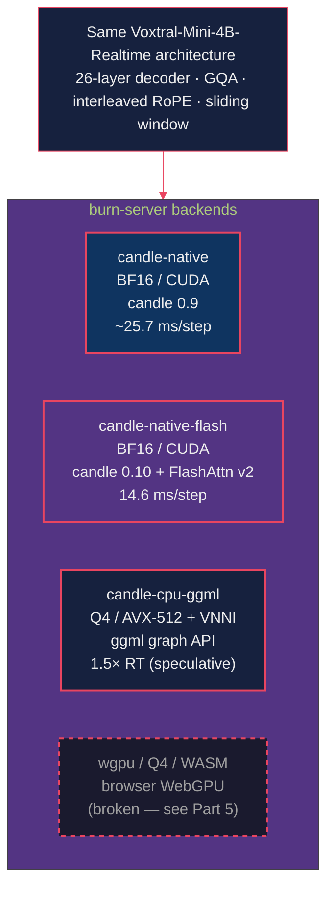
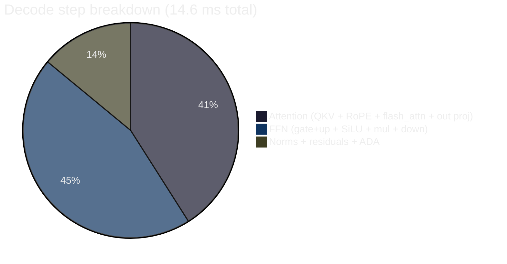
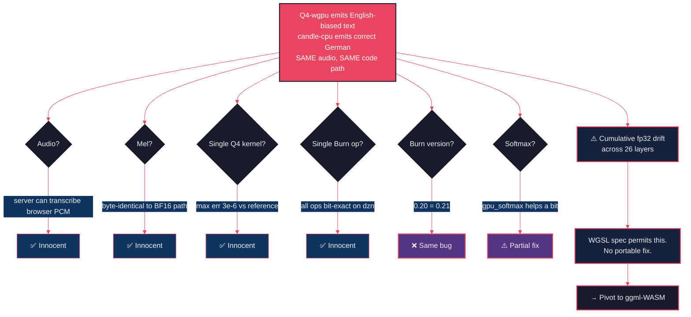

# Voxtral on Rust: Three GPU Backends, a CPU Streaming Engine, and the Five-Month WebGPU Dead-End I'd Like to Save You From

*Part 2 of the Starling series. Same model as Post 1, same UI, none of the Python. Plus FlashAttention v2, speculative decoding on a laptop, and one spectacular detour through the WGSL spec.*

---

[Post 1](../voxtral-asr-vllm/blog-post.md) showed Voxtral-Mini-4B-Realtime running on Python + vLLM. It works. It's fast. It also has the entire Python ecosystem strapped to its back.

`burn-server` is the same model, the same frontend, the same realtime caption experience — implemented in pure Rust with [candle](https://github.com/huggingface/candle) and [burn](https://github.com/tracel-ai/burn). One process owns the GPU directly. No vLLM, no torch, no FastAPI-spawning-a-subprocess. Just an Axum HTTP server holding a model.

This post is a tour of how it works, how fast it got, and the part where I spent five months proving that *yes, the WGSL spec really does say what it says about floating-point determinism*.

---

## Why bother? (or: "Why two servers for the same model?")

A few honest reasons:

1. **No Python in production**. One static binary, deterministic startup, no `pip install --upgrade` accidentally upgrading torch and breaking everything (cf. Post 3).
2. **Single-process ownership of the GPU**. The Python stack splits into FastAPI ↔ vLLM over WebSocket. The Rust stack has one process. Latency is lower, debugging is simpler, restarts are atomic.
3. **CPU and WASM as first-class targets**. Two of the four backends below run with no GPU at all. (Whether the WASM one *works* is a story we'll get to.)

The price: rebuilding 26 layers of Voxtral by hand and matching `voxtral.c` bit-for-bit. Worth it. Mostly.

Four backends share the same model file (`apps/burn-server/src/inference/`). Same Mel spectrogram. Same audio padding. Same streaming engine. The only thing that changes is the matmul provider underneath.

## Part 1: candle-native (BF16 CUDA, the reference)

The first backend was the "make it work" backend. Pure [candle](https://github.com/huggingface/candle) 0.9, BF16 weights, CUDA cuBLAS for matmul, all custom tensor wiring. The goal: produce *identical* output to [voxtral.c](https://github.com/antirez/voxtral.c) (antirez's reference C implementation) on the same audio.

A few non-obvious architecture details, because the spec docs lie a little:

- **Interleaved RoPE** (GPT-J style): pairs `(x[0], x[1]), (x[2], x[3])`, not split-half NeoX. If you copy a generic transformer codebase's RoPE, you will get *nearly correct* English transcription of German audio. It's diabolical.
- **Silence padding**: 32 mel frames of left silence + 17 frames of right silence around the audio. Both are needed; the encoder's CausalConv expects context on both sides.
- **Streaming prefix**: `BOS(1) + STREAMING_PAD(32) × 38 = 39 tokens` injected at the front of the decoder context. The trailing 38 pad tokens hold audio at prefix positions.
- **Boundary safety**: an 8-frame margin at the conv edge — boundary mel frames may shift when new audio arrives, so we treat the last 8 as provisional.
- **No right-padding on intermediate commits** — only the final flush gets right-pad. Get this wrong and your transcript ends 200 ms too early on every commit.

End-to-end this gets ~25.7 ms per decode step and ~7 s of encoder work for 300 s of audio. Total throughput: ~3× realtime on an RTX 5090. Fast enough for the demo. Not fast enough for me.

## Part 2: candle-native-flash (BF16 CUDA, 1.76× faster)

candle 0.10 ships three new fused ops that the standard candle path doesn't have. We use all three.

The three wins:

- **`candle_nn::ops::rms_norm`** — 1 CUDA kernel replaces 7 ops. There are 53 RmsNorm calls per decode step in this model. That's 53 × 6 = 318 fewer kernel launches.
- **`candle_nn::rotary_emb::rope_i`** — 1 kernel replaces ~36 ops. 26 calls per step.
- **`flash_attn_varlen` decode path** — avoids the KV-cache contiguous copy via a `squeeze(0)` contiguous view. Big enough to matter even at seq=1.

A few smaller wins that add up:

- **Zero-copy RoPE reshape**: for seq=1 decode, reshape instead of transpose+contiguous. No GPU copy.
- **Pre-cast BF16 RoPE tables**: cast cos/sin to BF16 at load time, not per-step.
- **Disabled CUDA event tracking**: single-stream inference, no cross-stream sync needed.
- **GPU argmax**: transfers 1 u32 from device-to-host instead of 131K floats per step.

Net result: **14.6 ms/decode step, 4.6 s encode for 300 s of audio**. 1.76× faster than the 0.9 baseline. The candle 0.10 + FlashAttention v2 stack is what `burn-server` uses by default in production.

Per-step the budget is roughly 6 ms for attention, 7 ms for FFN, 2 ms for everything else. Profiling shows ~74% of that is candle's per-op dispatch overhead (~22 µs/op × ~500 ops) and ~26% is GPU compute, bandwidth-limited. Future wins require fewer ops, not faster ops.

## Part 3: candle-cpu-ggml (Q4 on a laptop, streaming, correct)

CPU inference for a 4B-param ASR model sounds absurd. It is, until you remember that [ggml](https://github.com/ggerganov/ggml) (the engine behind llama.cpp) has spent two years making AVX-512+VNNI Q4 matmul go ridiculously fast. On a Ryzen 9 9955HX3D laptop (16c/32t, 96 MB L3, DDR5-5600), we get **1.5× realtime with correct text** via speculative decoding.

The three modes we benchmarked, all on the same 300 s `broadcast_1.wav`:

| Mode | Env | Speed | Text quality |
|---|---|---|---|
| **Speculative** ⭐ | `VOXTRAL_SPEC=1` | **1.50× RT** | ✅ Full German content |
| Sequential | (default) | 1.81× RT | ✅ Correct |
| Batched | `VOXTRAL_BATCH=6` | 0.86× RT | ❌ Broken ("Jahre Der" only) |

Speculative decoding (Leviathan et al. 2023) for an ASR model with a dual stream is a small adventure of its own:

1. **DRAFT pass**: batched forward, all N positions share `prev_token` (cheap, wrong).
2. **TRUNCATE**: roll back the KV cache via `KVCache::truncate_to`.
3. **VERIFY pass**: batched forward with corrected text embeddings `[prev_token, draft[0], …, draft[N-2]]`.
4. **ACCEPT** up to the first mismatch + sequential fallback for the rejected positions.

The cost per commit is 2 batched forwards (~150 ms each) + 0–2 sequential fallback steps. Acceptance rate is high — for ASR the audio dominates the prediction, so draft and verify mostly agree. Real speedup over pure sequential is ~17%.

**Things that surprised me when I profiled this:**

- Truncate is **0 ms** — `KVCache::truncate_to` uses tensor `narrow()` views, no memcpy.
- Reset commits (encoder KV reset every 150 frames, decoder every 300) are **fast**, ~370 ms encode-only. They aren't the P90 spikes.
- P90 is **100% acceptance-rate driven**: 25% of commits hit acc ≤ 3, which costs 4–5 sequential fallbacks at 120 ms each.

**Things I ruled out by profiling so you don't have to:**

- ❌ Ring-buffer KV cache — truncate has no cost to save.
- ❌ Async KV-reset — resets aren't slow.
- ❌ Jacobi / lookahead fallback — measured: same mean, +70 ms P90 worse.
- ❌ Padding M=6→8 — memory-bandwidth bound, no compute headroom.
- ❌ Pipeline encoder/decoder — encoder is only 24% of mean total.

The ceiling on this stack is around **1.40× RT**. Wins beyond that require architectural changes — Q4_K_M weights, layer culling, hybrid CPU+GPU — not algorithmic tricks.

```mermaid
%%{init: {'theme': 'base', 'themeVariables': {'primaryColor': '#1a1a2e', 'primaryTextColor': '#eee', 'lineColor': '#e94560', 'secondaryColor': '#0f3460'}}}%%
graph LR
    A[Audio chunk<br/>0.5 s commit] --> M[Mel<br/>incremental]
    M --> CN[CausalConv<br/>cached]
    CN --> E[Encoder<br/>+ KV reset every 150 frames]
    E --> R[Reshape ×4]
    R --> AD[Adapter]
    AD --> DR[DRAFT pass<br/>batched, wrong prev_token]
    DR --> TR[Truncate KV<br/>tensor narrow, 0 ms]
    TR --> VF[VERIFY pass<br/>batched, corrected prev_token]
    VF --> AC{Accept up to<br/>first mismatch}
    AC -->|tail rejected| FB[Sequential fallback<br/>120 ms × k]
    AC --> EM[Emit tokens<br/>sentence splitter]
    FB --> EM

    classDef stepStyle fill:#0f3460,stroke:#e94560,stroke-width:1px,color:#eee
    classDef hotStyle fill:#533483,stroke:#e94560,stroke-width:2px,color:#eee
    classDef coldStyle fill:#16213e,stroke:#e94560,stroke-width:1px,color:#eee

    class A,M,CN,R,AD coldStyle
    class E,DR,VF stepStyle
    class TR,AC hotStyle
```

A nice surprise: **streaming is faster than one-shot**. The streaming engine (1.56× RT) is **2.27× faster** than calling `transcribe()` on the same audio (3.54× RT). KV resets + speculative + incremental encoder beat the monolithic encode (54.7 s for 30 s of audio) and 429-step sequential decode of the one-shot path. There is no "streaming overhead" to claw back — streaming *is* the optimisation.

## Part 4: The WASM Q4 Dead End (or: How I Spent Five Months Learning That WGSL Is Permissive)

This is the cautionary tale.

Promise: ship Voxtral in the browser. Burn already has a wgpu backend that compiles to wasm32. Q4 weights fit. Browsers have WebGPU now. What could go wrong?

**Symptom**: streaming German news audio, the wasm engine emits coherent *English* ("Thank you. If you're interested in what's the most important thing about the West…"), with German finally emerging only after 12–15 commits of context. The exact same code on `candle-cpu-engine` (ggml, CPU) produces correct German throughout. So does `candle-native-flash` (cuBLAS). Just wgpu, just Q4, just wrong.

The bisection took five months. Every hypothesis got its own dedicated test, all on RTX 5090 via the dzn (DirectX-on-Linux) driver:

| Hypothesis | Verdict | Evidence |
|---|---|---|
| Audio resampling | ✅ innocent | Frontend's "Download decoded PCM" button → server `candle-cpu` transcribes the same PCM as correct German. |
| Mel computation | ✅ innocent | `voxtral-core/src/audio/mel.rs` byte-identical to `apps/burn-server/src/audio/mel.rs`. |
| Shared layer code | ✅ innocent | All files byte-identical to the BF16 path. |
| Q4 fused dequant+matmul WGSL | ✅ bit-exact | `q4_matmul_correctness` bin tests up to K=9216 → max abs err ≤ 3e-6. |
| Burn fp32 matmul on dzn | ✅ bit-exact | `burn_matmul_precision` bin → all OK. |
| Full RmsNorm composition | ✅ bit-exact | Same bin → OK. |
| GQA `expand_kv` reshape | ✅ correct | Same bin → OK. |
| Tiled vs naive Q4 dispatch | ✅ neutral | Always-naive: same English bias. |
| Browser WebGPU vs Linux dzn | ✅ same bug | Native dzn reproduces identically — *crucial*: I can repro in 2 s without spinning a browser. |
| Burn 0.20 → 0.21 / cubecl 0.9 → 0.10 | ❌ no fix | Identical broken output. Side win: 18% perf. |
| Replace burn softmax with matmul-based `gpu_softmax` | ❌ partial fix | Bumps quality from full English to partial German after ~12 commits. |
| `cpu_softmax` (max-shifted, mathematically correct) | ❌ counter-intuitive | Produces *fuller* English output (worse than `gpu_softmax`). |

After all of that, what's the actual bug?

**Cumulative fp32 accumulation drift across 26 decoder layers.** The DIAG_LOGITS dump tells the story at the same audio position:

- `candle-cpu` (correct): logit range `[-30, +11]`, STREAMING_PAD/STREAMING_WORD clearly dominate at silent positions.
- `Q4-wgpu` (broken): logit range `[-30, +3]`. *Compressed*. STREAMING_PAD doesn't dominate, random English text tokens win after the mask.

The hidden-state magnitude through 26 decoder layers drifts on dzn — not because any single op is buggy (every primitive op is bit-correct in isolation, verified above) — but because cumulative fp32 accumulation order across ~500 ops per token differs between drivers. **The WGSL spec does not guarantee bit-deterministic fp32 across implementations.** Different drivers will produce different drift profiles. There is no universal patch.

**What we shipped anyway**: `gpu_softmax` (matmul-based, DZN-safe) instead of `burn::tensor::activation::softmax` (uses broken `max_dim`/`sum_dim` on dzn). This raises wasm output quality from full English hallucination to partial German (German emerges after ~12 streaming commits). Not a fix; an improvement.

**What we're shipping next**: Path D — ggml-WASM. Compile ggml's exact CPU path to wasm32 with WASM SIMD. Quality matches server (deterministic accumulation order is the *reason* candle-cpu works). ~3–5× RT in the browser. Predictable across drivers. About a week of work. *Don't* re-attempt Path B (try-harder-with-WebGPU); the WGSL spec is what it is.

## Part 5: The Diagnostic Infrastructure That Made Any of This Tractable

The reason the WASM bisection took five months and not five years is that I built a couple of repro shortcuts early:

- **`libs/voxtral-core/src/bin/q4_incremental_test.rs`** — runs the same code as the wasm-engine on Linux dzn. ~2 s repro of any wasm bug. No browser needed.
- **`libs/voxtral-core/src/bin/q4_matmul_correctness.rs`** — bit-exactness regression test for the Q4 WGSL kernel. Any future kernel changes must pass this.
- **`libs/voxtral-core/src/bin/burn_matmul_precision.rs`** — Burn fp32 matmul precision tests on dzn. Rules out single-op regressions.
- **`DIAG_LAYERS=1`** in `q4/model.rs::forward_hidden_with_cache` — per-layer L2/min/max/first4 dump.
- **`DIAG_LOGITS=<base_path>`** in both `voxtral-core/q4/incremental_engine.rs` and `apps/burn-server/src/inference/candle_cpu/engine.rs` — dumps first 16 emission logits as `<base>.NN.bin` for cross-engine offline diff.
- **"Download decoded PCM" button** in `frontend/js/wasm/wasm-ui.js` — exports the browser's resampled audio as 16 kHz mono WAV for server-side comparison.

This is the "browser → server PCM round-trip" trick: when the wasm engine produces wrong output, dump its input audio and replay it through the server. If the server is correct, audio is innocent. If the server is also wrong, audio is the bug. *This eliminates an entire failure category in 30 seconds.*

## Part 6: Demo

90 seconds of Salzburg news, same `broadcast_1.wav` as Post 1, transcribed in the browser by the `candle-native-flash` backend. Same UI you saw in Post 1 — that's the joy of a shared frontend.

<video src="video.mp4" controls width="100%" muted playsinline></video>

(Captions appear within a couple of hundred ms of the audio. The model is fast; the latency floor is mostly accumulated PCM at this point, not inference.)

---

## Lessons From the Rust Side

**1. The shared frontend is doing a lot of heavy lifting.** Same HTML, same JS, same caption div, same `POST /api/sessions`. Two completely different backends. If you ever build two implementations of the same protocol, this trick alone pays for itself.

**2. Always use `init.sh` / `start.sh`, never bare `cargo build`.** The feature flags and binary paths are non-trivial. Bare cargo will compile *something*, but probably not the backend you wanted.

**3. Don't re-litigate Burn/wgpu Q4 numerics.** Cumulative fp32 drift cannot be patched away in a portable way. If you reach for a wgpu-Q4 fix, stop and ask why. Either: (a) you have a real single-op bug to find — different problem — or (b) you're trying to fix what cannot be fixed.

**4. Native CLI repros beat browser repros every time.** 2 s feedback loops change what's debuggable. Build them first.

**5. CPU is not a poor relation.** With Q4 + AVX-512 + ggml + speculative decoding, a single laptop CPU does live ASR at 1.5× realtime. That's a real product. The "GPU or bust" reflex is outdated.

## What's Next

Two posts down on the ASR side. Tomorrow's posts ([Post 3](../voxtral-tts-vllm/blog-post.md), [Post 4](../voxtral-tts-burn/blog-post.md)) swap direction: text in, audio out. Same model family, same dual-server pattern, very different problems — including a frontend audio pipeline that has *four layered DSP fixes* on top of "just play the bytes".

Cheers!
