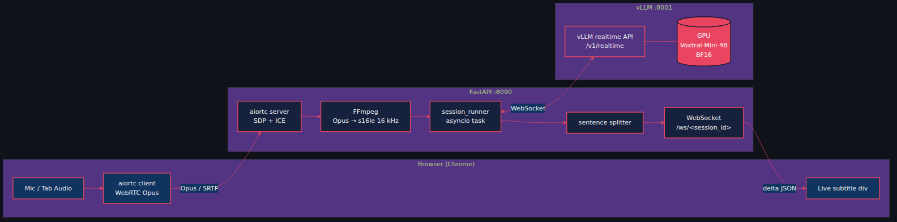
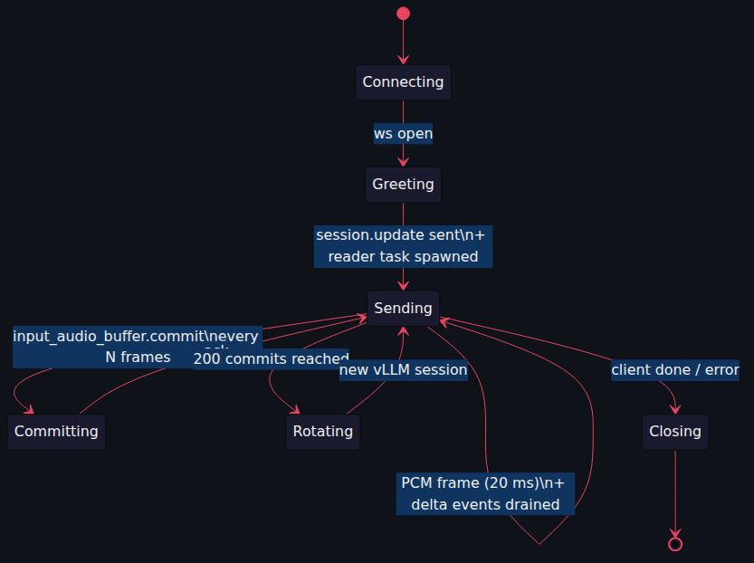
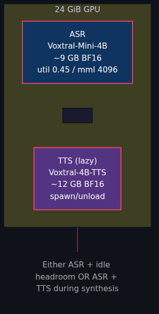
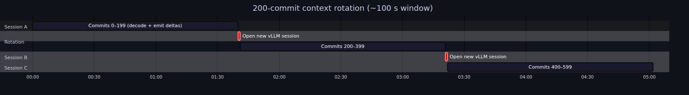

# Live German Subtitles in 700 ms: Voxtral-Mini-4B on vLLM's Realtime API

*A FastAPI server, an OpenAI-compatible WebSocket, and the asyncio plumbing that turns WebRTC audio into subtitles before the speaker finishes their sentence.*

---

You know the bit in every sci-fi film where someone speaks and crisp little subtitles appear under their chin? I wanted that. Locally. In German. On a single GPU.

The model exists: Voxtral-Mini-4B-Realtime, Mistral's encoder-decoder ASR model with a streaming mode. The runtime exists: vLLM, which ships an OpenAI-compatible Realtime API over WebSocket. How hard could gluing them together be?

*Reader, it was a learning experience.*

This is the first of four posts in the **Starling** series — two ASR posts (Python here, Rust next), two TTS posts (same split). Today: the Python side.

▶️ **Demo video** (90 s of Salzburg news → live German captions): <!-- TODO: YouTube URL -->

The MP4 is also committed alongside this post at `docs/blog/voxtral-asr-vllm/video.mp4`.

---

## The 30,000-foot view

Browser sends audio over WebRTC. We unpack it to 16 kHz PCM, push it to vLLM over a WebSocket, and stream the deltas back to the user as subtitles. Three sentences. Two weeks of implementation.

Three processes, four protocols (WebRTC, WebSocket, HTTP, the raw PCM pipe to FFmpeg), one cup of coffee per debugging session.

## The vLLM Realtime API tarpit

vLLM ships a WebSocket endpoint that pretends to be OpenAI's Realtime API. Three rules I learned the slow way:

**1. `--enforce-eager` or die.** Without it, torch.compile hits a FakeTensorMode bug. Eager mode costs throughput; eager mode is the only way that works.

**2. `session.update` first, or the server stares at you.** Connect the WebSocket, forget the session message, push audio — vLLM silently never replies. No error. Just silence. (My personal best on this debug: 90 minutes.)

**3. Read with a background task.** The audio loop calls `send_bytes(pcm)` every 20 ms. If you `recv()` inline, you stall the producer. Dedicated reader task. Always.

## FFmpeg, the polite middleman

WebRTC delivers Opus at 48 kHz. Voxtral wants linear PCM at 16 kHz. FFmpeg sits in the middle, taking Opus on stdin and emitting `s16le` on stdout, never quite dying when you want it to.

Two gotchas:
- The session runner waits for `client_ready` from the browser before starting FFmpeg, or it spends the first 800 ms transcribing silence.
- We let FFmpeg do the resample, not aiortc — `aresample` is faster and matches Whisper's training distribution better.

## Sentences that don't quite make sense

Real German news transcripts look like this:

> *Dr. Wolfgang Sobotka hat am 19. November 2025 um 14:30 Uhr ein Statement abgegeben…*

Naïve `text.split(".")` gives you four "sentences" and three meltdowns. The splitter has to handle honorifics (`Dr.`, `St.`, `vs.`), ordinals with dates (`19. November`), decimals (`3.14`), ellipses, and quote-terminators. There's a [pytest file with 24 cases](https://github.com/gjovanov/starling/blob/master/apps/vllm-server/tests/test_tts_text.py) that runs on every commit. The same regex powers the TTS server's long-form sentence splitter — the kind of code reuse that makes a monorepo earn its keep.

## ASR + TTS coexistence

Voxtral-Mini-4B takes ~9 GB of VRAM. Voxtral-4B-TTS takes ~12 GB. On a 24 GiB GPU, **9 + 12 > 24**, so we cannot have both loaded.

We squeeze ASR into a smaller share (`--gpu-memory-utilization 0.45 --max-model-len 4096`) and let TTS auto-spawn / auto-unload on demand. Post 3 explains the lifecycle manager; for now, the ASR server is the polite tenant.

Lowering `max-model-len` from 16384 to 4096 was a free win — ASR sessions rotate context every ~100 s of audio, so we never use more than ~1200 tokens of KV. Reserving 16 K of KV cache for 1.2 K of usage is just paying rent on empty rooms.

## Context rotation

Voxtral's decoder has a sliding window of 8192 tokens. Stream audio forever and it runs out of room. Mitigation: every 200 commits (~100 s of audio), close the vLLM session and open a fresh one. The frontend doesn't notice; the backend swaps under the hood.

Rotation cost is dominated by the ~80 ms of session bring-up; tiny compared to the second-or-so we'd lose if we let the KV cache fill.

---

## Lessons I took the slow way

- **CPU inference is not viable.** Voxtral's encoder takes 2–3 seconds per second of audio on CPU. The Python path is a dead end without a GPU. (Post 2's burn-server CPU path hits 1.5× realtime via Q4 + speculative decoding — but that's Rust.)
- **`--enforce-eager` is non-negotiable.** I tried the compiled path three ways. Each time, a different FakeTensorMode error.
- **Silence-on-misconfiguration is vLLM's worst design choice.** Send `session.update` immediately and treat 5 s of silence as a connection error.
- **WebRTC audio levels are not normalised.** Tab audio comes in at peak −6 dB, mic audio at −24 dB. Voxtral handles both; downstream consumers may not.

## What's next

- **Post 2** — the same model in Rust on `burn-server`. Three GPU backends, a CPU streaming engine, and a spectacular WebGPU dead-end I'd love to save you from repeating.
- **Post 3** — Voxtral-4B-TTS on `vllm-server`. Text in, audio out. 20 voices, streaming WAV, GPU subprocess that politely tags out so ASR can play.
- **Post 4** — the TTS model in native Rust. 386 BF16 tensors, one bit-exact flow-matching autoregressor.

Code, MP4s, and pain are all at the top of the repo.

Cheers!
