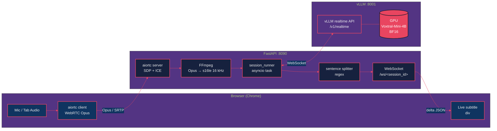
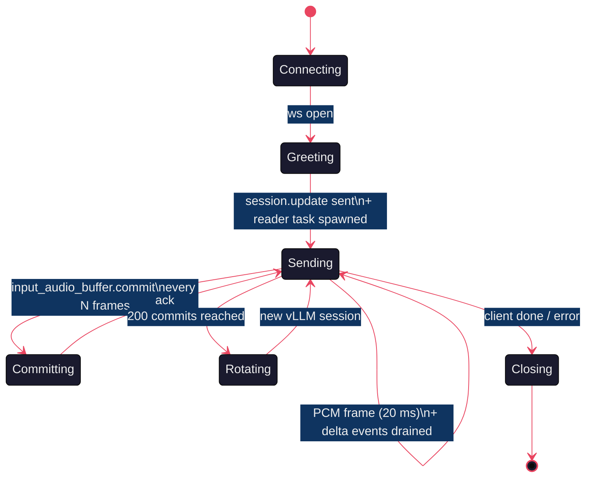
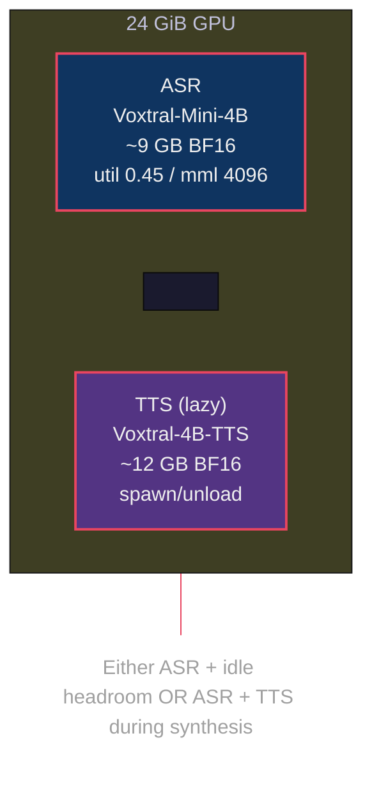

# Live German Subtitles in 700 Milliseconds: Voxtral-Mini-4B on vLLM's Realtime API

*Part 1 of the Starling series. A FastAPI server, a hungry GPU, an OpenAI-compatible WebSocket, and the assorted asyncio plumbing that makes WebRTC audio come back out as subtitles before the speaker has finished their sentence.*

---

You know the bit in every sci-fi film where someone speaks into the air and crisp little subtitles appear under their chin? Yeah. I wanted that. Locally. In German. On a single GPU. For free.

The model exists: [Voxtral-Mini-4B-Realtime](https://huggingface.co/mistralai/Voxtral-Mini-4B-Realtime), Mistral's encoder-decoder ASR model with an honest-to-god streaming mode. The runtime exists: [vLLM](https://github.com/vllm-project/vllm), which ships an OpenAI-compatible Realtime API over WebSocket. So how hard could gluing them together be?

Reader, *it was a learning experience*.

This is the first of four posts in the Starling series. The repo is a monorepo with two servers — `vllm-server` (Python, this post) and `burn-server` (Rust, Post 2) — both speaking the same frontend protocol over WebRTC. Both run two models: Voxtral-Mini-4B-Realtime for ASR, and (Posts 3 & 4) Voxtral-4B-TTS-2603 for the other direction.

Today: how the Python side works. And every place I got it wrong before I got it right.

---

## Part 1: The 30,000-Foot View

Browser sends audio over WebRTC. We unpack it to 16 kHz PCM, push it to vLLM over a WebSocket, and stream the deltas back to the user as subtitles. That's three sentences. Implementation took two weeks.



Three processes, four protocols (WebRTC, WebSocket, HTTP, the raw PCM pipe to FFmpeg), one cup of coffee per debugging session. The frontend is shared with `burn-server`, so the same UI you see in Post 2 (Rust) also drives this Python stack — same `POST /api/sessions`, same `WS /ws/<id>`, same caption div.

## Part 2: The vLLM Realtime API Tarpit

vLLM ships a beautiful little WebSocket endpoint that pretends to be OpenAI's Realtime API. The contract is: open the socket, send a `session.update`, push audio, listen for `response.audio_transcript.delta` events.

Beautiful. *In theory.* In practice, you discover three rules:

**Rule 1 — `--enforce-eager` or die.** Without it, vLLM tries to torch.compile the encoder and hits a [FakeTensorMode bug](https://github.com/vllm-project/vllm/issues) that surfaces as a polite-but-fatal `RuntimeError` about a year into your debugging session. The fix:

```bash
vllm serve $MODEL_PATH \
    --enforce-eager \
    --gpu-memory-utilization 0.45 \
    --max-model-len 4096
```

Yes, eager mode costs a bit of throughput. No, you don't get to skip this one. The 0.45 memory util and 4096 context length are deliberate too — see [Part 5](#part-5--asr--tts-coexistence).

**Rule 2 — `session.update` first or the server stares at you.** vLLM's realtime endpoint will accept the connection, accept your binary audio frames, and silently never reply. If you forget to send the `session.update` message with the right audio format declaration, the model never engages. There's no error. Just silence. (My personal best on this debug: 90 minutes.)

```python
await ws.send_json({
    "type": "session.update",
    "session": {
        "input_audio_format": "pcm16",
        "input_audio_transcription": {"language": "de"},
        "turn_detection": None,  # we drive commits ourselves
    },
})
```

**Rule 3 — read with a background task, never with `await ws.recv()` in your audio loop.** This one's mine; it cost me an afternoon. The audio-push loop calls `await ws.send_bytes(pcm_chunk)` every 20 ms; if you `await recv()` between sends, you stall the producer. Use a dedicated reader task.



The state machine lives in `apps/vllm-server/voxtral_server/transcription/vllm_client.py` and the runner that drives it is in `transcription/session_runner.py`. There's a tiny ceremony around the `input_audio_buffer.commit` event — vLLM treats every commit as "decode now" — and we issue them deliberately every ~500 ms of audio. Too often: GPU thrashes. Too rarely: latency climbs past one second and the demo loses its sparkle.

## Part 3: FFmpeg and the Audio Plumbing

WebRTC delivers Opus frames at 48 kHz. Voxtral wants linear PCM at 16 kHz. Standing between them: FFmpeg, running as a subprocess, taking RTP-decoded Opus on its stdin and producing `s16le` on its stdout, never quite dying when you want it to.

```python
# voxtral_server/audio/ffmpeg_source.py (paraphrased)
cmd = [
    "ffmpeg", "-hide_banner", "-loglevel", "error",
    "-f", "opus", "-i", "pipe:0",
    "-ar", "16000", "-ac", "1",
    "-f", "s16le", "-",
]
proc = await asyncio.create_subprocess_exec(*cmd, stdin=PIPE, stdout=PIPE)
```

Two gotchas:

1. **The aiortc `AudioStreamTrack` resamples for you if you ask politely.** We bypass that and let FFmpeg do it because FFmpeg's `aresample` is faster and the resulting samples match Whisper's training distribution closer than the Python resampler. (Mel-spectrogram code is in `voxtral.c` / `apps/burn-server/src/audio/mel.rs` if you want to verify.)
2. **The session runner waits for a `client_ready` event before starting FFmpeg.** Without it, the model is fed silence until the browser finishes its ICE dance. Captions would appear, but offset by 800 ms — not great for an "instant subtitles" demo.

## Part 4: Sentences That Don't Quite Make Sense

The realtime API emits text deltas. We want sentences. That sounds like a split-on-period job. It is not.

Real German news transcripts look like this:

> *Dr. Wolfgang Sobotka hat am 19. November 2025 um 14:30 Uhr ein Statement abgegeben…*

Naïve `text.split(".")` gives you four "sentences" and three meltdowns. The splitter in `voxtral_server/transcription/session_runner.py` has to handle:

- **Honorifics**: `Dr.`, `Mr.`, `Mrs.`, `St.`, `vs.`, `etc.`
- **Ordinals with dates**: `19. November`, `am 17.`, `3. Bundesliga`
- **Decimal numbers**: `3.14`, `12.5 km/h`
- **Ellipses**: `…` and `...` (treat as soft pause)
- **Quote terminators**: `."` and `?"` (keep the closing quote on the same sentence)

The result is a regex that looks alarming but is well-tested. There's a [pytest file with 24 cases](../../../apps/vllm-server/tests/test_tts_text.py) that runs on every commit; it's *also* used by the TTS server's long-form splitter, which is the kind of code reuse that makes a monorepo earn its keep.

## Part 5 — ASR + TTS coexistence

Voxtral-Mini-4B (ASR) takes ~9 GB of VRAM in BF16. Voxtral-4B-TTS-2603 (TTS) takes ~12 GB. The math is straightforward: **9 + 12 > 24**. On a 24 GiB GPU you cannot have both loaded at once.

So we don't. We squeeze the ASR model into a smaller share of VRAM (`--gpu-memory-utilization 0.45 --max-model-len 4096`) and let the TTS subprocess auto-spawn / auto-unload on demand. The lifecycle manager (`voxtral_server/tts/lifecycle.py`) is the topic of Post 3 — for now, just know that the ASR server is the polite tenant.



Lowering `max-model-len` from the default 16384 to 4096 was a non-obvious win: ASR sessions rotate context every ~100 s of audio anyway, so we never use more than ~1200 tokens of KV. Reserving 16 K of KV cache for a workload that uses 1.2 K is just paying rent on empty rooms.

## Part 6 — Context Rotation

Voxtral's decoder has a sliding window of 8192 tokens. The encoder window is 750. In practice that means *if you stream audio at it forever, it will run out of room*. Doable mitigations:

- **Encoder KV**: nothing fancy — vLLM's realtime API resets it per session, and we issue a new commit every ~500 ms.
- **Decoder KV**: every 200 commits (~100 s of audio), we close the vLLM session and open a fresh one. The frontend doesn't notice; the backend swaps under the hood.

```mermaid
%%{init: {'theme': 'base', 'themeVariables': {'primaryColor': '#1a1a2e', 'primaryTextColor': '#eee', 'lineColor': '#e94560', 'secondaryColor': '#0f3460'}}}%%
gantt
    title 200-commit context rotation (~100 s window)
    dateFormat HH:mm:ss
    axisFormat %M:%S
    section Session A
    Commits 0–199 (decode + emit deltas) :a1, 00:00:00, 100s
    section Rotation
    Open new vLLM session                :crit, r1, after a1, 1s
    section Session B
    Commits 200–399                      :a2, after r1, 100s
    section Rotation
    Open new vLLM session                :crit, r2, after a2, 1s
    section Session C
    Commits 400–599                      :a3, after r2, 100s
```



The trick that lets this be invisible: the splitter's emitted sentences flush before the rotation, and the rotation itself happens *between* commits, not *during* one. Rotation cost is dominated by the ~80 ms of vLLM session bring-up; tiny compared to the second-or-so we'd lose if we let the KV cache fill.

## Part 7 — Demo: 90 seconds of Salzburg news

This bit demos best in motion. The clip is `media/broadcast_1.wav`, an Austrian regional news broadcast — German, two anchors, a couple of foreign names (Mahrer, Bischofshofen, Carabinieri Saal). The recording shows the frontend uploading the clip, creating a session, and watching the live caption div fill in.

<video src="video.mp4" controls width="100%" muted playsinline></video>

> **Embedding note**: the MP4 is committed alongside this post. If you're reading on GitHub, the video plays inline. The same clip is also on YouTube — see the Medium variant of this post for the link.

You'll notice the caption starts about 700 ms after audio begins. That's the latency budget: ~500 ms accumulated PCM + ~200 ms model + ~negligible network. Not zero. Not human-imperceptible. But comfortably under the threshold where a reader's eye would notice it lagging.

## Part 8 — Lessons I Took the Slow Way

**1. CPU inference is not viable for this workload.** Voxtral's encoder takes 2–3 seconds per second of audio on CPU. At that rate "realtime" is a cruel joke. We tried; it was sad. If you don't have a GPU, jump to [Post 2](../voxtral-asr-burn/blog-post.md) where the burn-server's CPU path uses Q4 + speculative decoding and clocks ~1.5× realtime — but the Python path on CPU is a dead end.

**2. `--enforce-eager` is non-negotiable.** I tried the compiled path three different ways. Each time, a different `FakeTensorMode` error. Eager mode wins. Save your weekend.

**3. The Realtime API's silence-on-misconfiguration is the worst design choice in the whole stack.** A polite "you forgot session.update" would have saved me an evening. Workaround: send the `session.update` immediately and treat any 5 s of silence as a connection error.

**4. WebRTC audio levels are not normalized.** Tab audio comes in at peak −6 dB, mic audio at −24 dB or so. We don't normalise on the Python side — the model is robust enough — but if you're chaining ASR into something else, do.

**5. The frontend lives in `frontend/`, shared with `burn-server`.** This is convenient: the same HTML/JS exercises both backends. It also means the frontend cannot use Python-isms. Every API surface is plain HTTP/JSON. Worth it.

## What's Next

This post covered the Python implementation. [Post 2](../voxtral-asr-burn/blog-post.md) is the same model on the same UI, but in Rust — pure candle, no Python at all, three GPU backends, a CPU streaming engine, and the spectacular WebGPU dead end I'd love to save you from repeating.

After that, [Post 3](../voxtral-tts-vllm/blog-post.md) goes the other direction: text in, audio out, via vllm-omni, with a lifecycle manager that politely tags the ASR model out of the GPU when synthesis starts. And [Post 4](../voxtral-tts-burn/blog-post.md) is the Rust port of the TTS model — 386 BF16 tensors, one bit-exact flow-matching autoregressor, and a voice-cloning checkpoint that's missing weights.

If any of this was useful, the code is at the top of the repo, the demos are in `media/`, and the brave can fork the lot.

Cheers!
