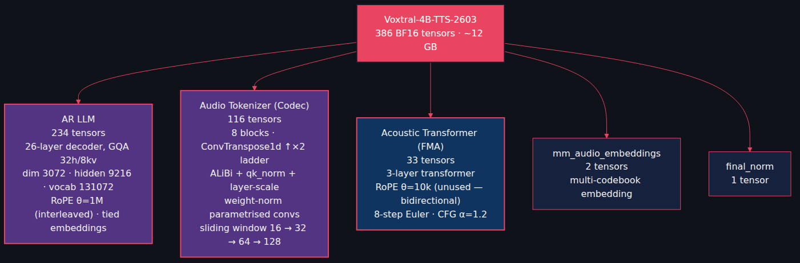
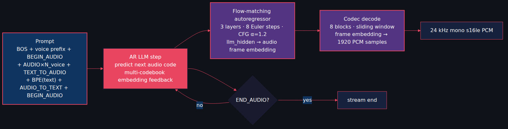
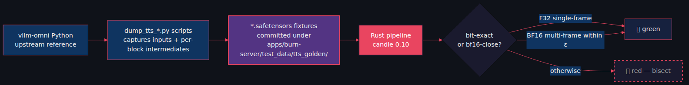
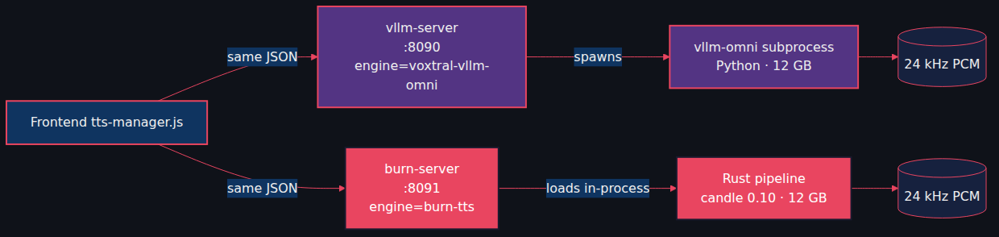

# Porting Voxtral-4B-TTS to Native Rust: 386 BF16 Tensors, Bit-Exact FMA, and No Encoder Weights

*Part 4, the final post in the Starling series. Same model as Post 3, no Python in the production path.*

---

[Post 3](https://github.com/gjovanov/starling/blob/master/docs/blog/voxtral-tts-vllm/blog-post-medium.md) shipped Voxtral-4B-TTS through vllm-omni and FastAPI. It works. It also drags the entire Python ecosystem along for the ride.

Post 2 made the same argument for the ASR model. We won. So we did it again for TTS.

Phase 2 (2026-04-26 → 2026-05-02): full Voxtral-4B-TTS-2603 from the upstream Python reference to native Rust + candle 0.10. End-to-end pipeline running on the real 4B-param checkpoint. Same `/api/tts/*` routes as the Python server. Same frontend. At runtime, zero Python.

▶️ **Demo video** (~150 words of German news, Rust backend — A/B against Post 3): <!-- TODO: YouTube URL -->

The MP4 is at `docs/blog/voxtral-tts-burn/video.mp4`.

---

## The model is three submodels

Not "one big model" — three submodels plus two helper tables, 386 BF16 tensors, ~12 GB on disk.



- **AR LLM** ≈ Voxtral-Mini's ASR decoder *minus* the audio-conditioning ADA layer. ~90% reuses the candle-native-flash patterns from Post 2.
- **FMA** — 3-layer transformer, bidirectional attention over `[noise, t_emb, llm_hidden]`, 8-step Euler integration, CFG α = 1.2. Small.
- **Codec** — the interesting one. 8 blocks, each `attention → weight-norm conv → ConvTranspose1d ↑×2 → weight-norm conv → attention`. ALiBi + qk_norm + layer-scale. Sliding window 16 → 32 → 64 → 128.

## The synthesis loop



1. Build the prompt: `BOS, BEGIN_AUDIO, AUDIO × N_voice, TEXT_TO_AUDIO, BPE(text), AUDIO_TO_TEXT, BEGIN_AUDIO`. `N_voice` comes from the voice embedding's `n_rows()`.
2. AR LLM predicts the next frame's audio codes. Tied embeddings (LM head shares weights with input table).
3. FMA turns the LLM hidden state into a per-frame audio embedding (8 Euler steps + CFG).
4. Codec decodes one frame's embedding into 1920 PCM samples (24000 / 12.5 = 1920 at 12.5 fps).
5. Halt when the AR LLM predicts `END_AUDIO`.

## Bit-exact validation

A TTS model is judged by ear. "Sounds right" is not a regression test. So we wrote a harness that doesn't trust ears.



For both the FMA and the codec:

- **Single-frame F32**: capture intermediate tensors from upstream at every block boundary, run our Rust pipeline on the same input, assert bit-exact equality. **The FMA passes through all 3 layers + every Euler step. The codec passes through every one of its 8 blocks.**
- **Multi-frame BF16**: matches within bf16 autocast precision.

Fixtures committed under `apps/burn-server/test_data/tts_golden/`:
- 6 FMA fixtures (3 inputs × 2 dtypes)
- 6 codec fixtures (per-block intermediates)
- 6 e2e WAV/JSON pairs
- 6 prompt_ids fixtures (chat-template byte-exact regression)

Plus capture scripts under `apps/vllm-server/scripts/`. F32 bit-exactness is a green CI gate, not aspirational.

## Parity with the Python server

The frontend doesn't change. So the routes don't change.



Same 9 endpoints. Same lifecycle (load on first hit, unload after 600 s idle). `GET /api/tts/status` reports `engine: "burn-tts"` vs `"voxtral-vllm-omni"` so the frontend can show an identity badge — you actually know which backend just produced the audio.

In-flight synth counting uses `Arc::strong_count` on the stored pipeline `Arc`. No separate atomic; the watcher only unloads when no caller holds a reference. The Arc *is* the counter.

## Voice cloning — the same asterisk

Storage works: `POST /api/tts/voices/upload`, `_audit.log` records id/name/timestamp/permission (never the audio bytes or transcript), listing, delete.

Synthesis returns 501, because the open-source Voxtral-4B-TTS-2603 checkpoint ships without `audio_tokenizer.input_proj.*` and `audio_tokenizer.encoder_blocks.*` — the codec *encoder* needed to tokenise reference audio. Without those, there's no way to turn an uploaded WAV into audio codes the AR LLM can prefix.

```bash
cargo run --release --features voxtral-tts --bin dump-tts-weights
```

inventories the loaded checkpoint and prints "voice cloning: NOT SUPPORTED (encoder weights missing)" at the bottom of its output. Documented up front, not hidden.

## What's still open

- **Phase 3-C: F32 bit-exact end-to-end regression.** FMA single-step is the anchor; missing is upstream-side capture of per-step `torch.randn` so we can replay the same noise in Rust. ~½ day in upstream's spike scripts. `pipeline.synthesize` already accepts a replay-able `noise: &Tensor`.
- **Phase 3-F: per-frame streaming via codec windowed-decode.** Per-sentence streaming is already in. Per-frame would cut latency further but is high-risk (codec is stateful — sliding-window transformers plus ConvTranspose1d right-trim). ~2–3 days with K=10 frame windows.

Neither is blocking the production path.

## Lessons

- **Bit-exact tests on F32 fixtures keep you honest.** "Sounds similar" is a regression test that fails silently. "F32 every-block-output matches Python byte-for-byte" cannot.
- **The candle-native-flash patterns ported cleanly.** ~90% of the AR LLM was a rename-and-go from the ASR Mini decoder. RmsNorm, RoPE, GQA, sliding-window — same shapes, same fused kernels.
- **Document missing checkpoint weights explicitly, in the API.** A 501 with a specific weight name beats a `KeyError` deep in the bowels.
- **`Arc::strong_count` is a perfectly good in-flight counter.** No separate atomic; no leak; no race.
- **Engine identity badges matter when you have two backends.** Otherwise "did this audio come from the Python or Rust server?" becomes a four-minute investigation.

## Closing the series

That's the four-part Starling tour:

- **Post 1** — ASR via Python + vLLM. Live German captions over WebRTC.
- **Post 2** — ASR via Rust + candle/burn. Three GPU backends, a CPU streaming engine, one WebGPU dead-end.
- **Post 3** — TTS via Python + vllm-omni. 20 voices, streaming WAV, GPU lifecycle, four DSP fixes.
- **Post 4** — TTS via Rust + candle. 386 BF16 tensors, bit-exact FMA, bit-exact codec, no Python in production.

Two models. Two servers. One frontend. Four backends. One static binary in the production critical path.

If you've read all four — cheers, and thank you. If you've forked the repo, I'll buy you a coffee. If you've shipped something on top of this, please send a link.

Cheers!
