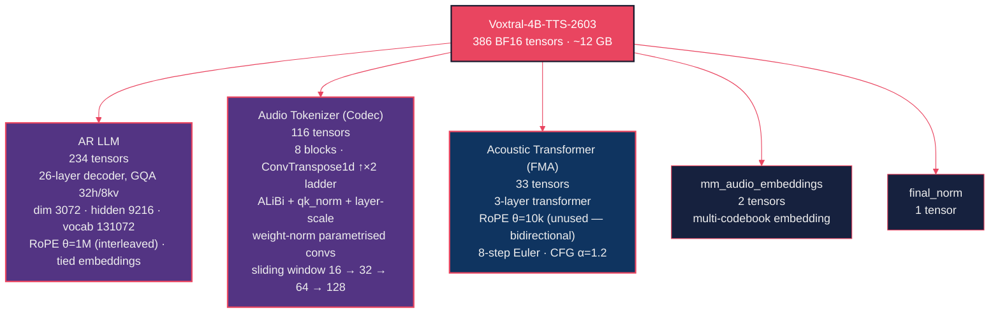
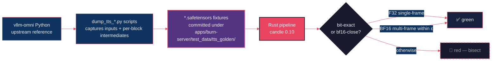
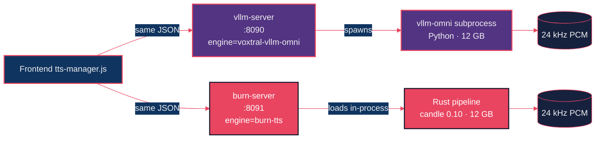

# Porting Voxtral-4B-TTS to Native Rust: 386 BF16 Tensors, One Bit-Exact FMA, and No Encoder Weights

*Part 4, the final post in the Starling series. Same model as Post 3, no Python in the production path. A flow-matching autoregressor that matches the Python reference to the last fp32 bit, a codec with sliding-window attention and weight-norm convolutions, and an open-source checkpoint that's almost — but not quite — voice-cloneable.*

---

[Post 3](../voxtral-tts-vllm/blog-post.md) showed how to ship Voxtral-4B-TTS through `vllm-omni` and FastAPI. It works. It's fast. It also drags every line of Python that vllm-omni pulls in along with it: torch, transformers, attention implementations, tokeniser registries, the whole party.

Post 2 made the same argument about the ASR model: same UI, no Python, single Axum process. We won. So we did it again for TTS.

This is that port. Phase 2 (2026-04-26 → 2026-05-02): full Voxtral-4B-TTS-2603 from the upstream Python reference to native Rust + candle 0.10. End-to-end pipeline running on the real 4B-param checkpoint. Same `/api/tts/*` HTTP surface as the Python server, same frontend, same audio in the browser — and at runtime, no Python at all.

---

## Part 1: The Model Has Three Modules and a Couple of Friends

Voxtral-4B-TTS is not "one big model". It's three submodels that pass tensors to each other, plus two helper tables. Total: 386 BF16 tensors, ~12 GB on disk. The breakdown — re-derived from the safetensors index, anchored in our `weights.rs` inventory — is:



A useful mental model:

- **AR LLM** ≈ Voxtral-Mini's ASR decoder, minus the audio-conditioning ADA layer. ~90% of the candle-native-flash patterns from [Post 2](../voxtral-asr-burn/blog-post.md) reuse here.
- **FMA** is small. 3 layers. Bidirectional attention over a 3-token window of `[noise, t_emb, llm_hidden]`. 8-step Euler integration. Classifier-free guidance α = 1.2.
- **Codec** is the interesting one. 8 blocks, each is `attention → weight-norm conv → ConvTranspose1d upsample → weight-norm conv → attention`. ALiBi positional bias (so attention is shift-invariant), `qk_norm` (stabilises long-range attention), layer-scale (training trick that ports cleanly to inference).

The whole thing is in `apps/burn-server/src/inference/voxtral_tts/`. The directory layout maps 1:1 to the modules above (`ar_llm/`, `codec/`, `flow_matching/`).

## Part 2: The AR LLM Loop and the FMA

How synthesis actually works:

```mermaid
%%{init: {'theme': 'base', 'themeVariables': {'primaryColor': '#1a1a2e', 'primaryTextColor': '#eee', 'lineColor': '#e94560', 'secondaryColor': '#0f3460'}}}%%
graph LR
    PROMPT[Prompt<br/>BOS + voice prefix + BEGIN_AUDIO<br/>+ AUDIO×N_voice + TEXT_TO_AUDIO<br/>+ BPE(text) + AUDIO_TO_TEXT + BEGIN_AUDIO]
    AR[AR LLM step<br/>predict next audio code<br/>multi-codebook embedding feedback]
    FMA[Flow-matching autoregressor<br/>3 layers · 8 Euler steps · CFG α=1.2<br/>llm_hidden → audio frame embedding]
    CODEC[Codec decode<br/>8 blocks · sliding window<br/>frame embedding → 1920 PCM samples]
    PCM[24 kHz mono s16le PCM]
    HALT{END_AUDIO?}

    PROMPT --> AR
    AR --> FMA
    FMA --> CODEC
    CODEC --> PCM
    AR --> HALT
    HALT -->|no| AR
    HALT -->|yes| DONE[stream end]

    classDef hotStyle fill:#e94560,stroke:#1a1a2e,stroke-width:2px,color:#fff
    classDef warmStyle fill:#533483,stroke:#e94560,stroke-width:2px,color:#eee
    classDef coldStyle fill:#0f3460,stroke:#e94560,stroke-width:2px,color:#eee
    classDef outStyle fill:#16213e,stroke:#e94560,stroke-width:1px,color:#eee

    class AR hotStyle
    class FMA,CODEC warmStyle
    class PROMPT coldStyle
    class PCM,DONE outStyle
```

Walk through it:

1. **Prompt construction** (`chat_template.rs`): `BOS, BEGIN_AUDIO, AUDIO × N_voice, TEXT_TO_AUDIO=36, BPE(text), AUDIO_TO_TEXT=35, BEGIN_AUDIO`. `N_voice` comes from the voice embedding's `n_rows()` — 20 built-in voices, each a `[N_voice, 3072]` tensor under `voices/<name>.safetensors`.
2. **AR step**: each forward pass takes a multi-codebook embedding from the previous frame's audio codes (`embed.rs`) and predicts the next frame's codes. Tied embeddings — the LM head shares weights with the input embedding table.
3. **FMA**: the LLM's hidden state at the predicted position becomes the `llm_hidden` conditioning input to a 3-token bidirectional attention window. 8 Euler integration steps starting from Gaussian noise. CFG mixes a conditioned and unconditioned trajectory with α = 1.2.
4. **Codec**: the FMA's output (per-frame audio embedding) is fed into the 8-block decoder ladder, producing 1920 PCM samples per frame (24000 / 12.5 = 1920 samples at 12.5 fps).
5. **Halt**: the AR LLM has an `END_AUDIO` token in vocabulary. When it predicts it, synthesis stops.

The autoregressor lives in `autoregressor.rs`, the prompt builder in `chat_template.rs`, the AR/FMA/codec submodules in their respective directories. The whole pipeline composes in `pipeline.rs::TtsPipeline::synthesize`.

## Part 3: Bit-Exact Tests (or: How Do You Validate a 12 GB Model?)

This is where the port could have failed quietly. A TTS model's output is judged by ear. "Sounds right" is not a regression test. So we wrote a test harness that doesn't trust ears.

For both the FMA and the codec, we run two evaluations:

- **Single-frame bit-exact (F32)**: capture intermediate tensors from upstream (`apps/vllm-server/scripts/dump_tts_fma.py`, `dump_tts_codec.py`) at every block boundary, run our Rust implementation on the same input, assert that every tensor matches up to fp32 bit-exact equality. **The FMA passes through all 3 layers + every Euler step. The codec passes through every single one of its 8 blocks.**
- **Multi-frame (BF16 autocast)**: same approach but on a longer sequence. Matches within bf16 autocast precision (small per-element differences from operand-order non-determinism in BF16 accumulation).



The fixtures committed under `apps/burn-server/test_data/tts_golden/`:

- **6 FMA fixtures** — 3 synthetic `llm_hidden` inputs × 2 dtypes → audio_codes (F32 bit-exact).
- **6 codec fixtures** — synthetic codes → 24 kHz PCM with every per-block intermediate (single-frame bit-exact).
- **6 e2e WAV/JSON pairs** — real text → audio via the running vllm-omni HTTP API (seed-dependent, audible-only sanity).
- **6 prompt_ids fixtures** — chat-template byte-exact regression (so a tokenizer change can't silently break the prompt).

Plus three capture scripts under `apps/vllm-server/scripts/`. To re-capture (when upstream updates), run the dump scripts against a running vllm-omni and the fixtures are refreshed.

The "the FMA is F32 bit-exact" claim is not aspirational — it's a green CI gate. Every fresh build runs `cargo test --release --features voxtral-tts --lib voxtral_tts::` and validates against these fixtures.

## Part 4: HTTP Routes and Lifecycle (Parity With Python)

The whole point of the port is that the frontend doesn't change. So the routes don't change either:

| Method | Path | What it does |
|---|---|---|
| `GET` | `/api/tts/voices` | 20 built-in voices + cloned voices |
| `GET` | `/api/tts/config` | 24 kHz, 12.5 fps, 1920 samples/frame, 37 codebooks |
| `GET` | `/api/tts/status` | lifecycle snapshot — `state`, `loaded`, `inflight_synths`, `last_activity_secs`, `engine` |
| `POST` | `/api/tts/synthesize` | text-input synthesis (long-form, per-sentence streaming) |
| `POST` | `/api/tts/synthesize-codes` | pre-tokenized synthesis escape hatch |
| `GET` | `/api/tts/output[/{name}]` | list / fetch saved WAV files |
| `DELETE` | `/api/tts/output/{name}` | delete a saved WAV |
| `POST` | `/api/tts/voices/upload` | multipart voice-ref upload |
| `DELETE` | `/api/tts/voices/{ref_id}` | delete a cloned voice ref |

The lifecycle is also parity. The pipeline loads on the first `/api/tts/*` hit, auto-unloads after `BURN_TTS_IDLE_UNLOAD_SECS` (default 600 s), reloads on the next call. In-flight synth count is tracked implicitly via `Arc::strong_count` on the stored pipeline `Arc` — the watcher only unloads when no caller holds a reference. No separate counter; no race condition with cleanup. Code: `tts_routes.rs::TtsLifecycleState`.

`GET /api/tts/status` reports `engine: "burn-tts"` for the Rust server and `engine: "voxtral-vllm-omni"` for the Python server. The frontend reads this and shows an identity badge — so when you're watching the demo, you actually know which backend just produced the audio.



Long-form synthesis (Phase 3-A) reuses the same sentence splitter Post 1 documented, in reverse. Per-sentence streaming through an `mpsc::Sender` → `Body::from_stream`. Client disconnect closes the receiver and aborts the synth task. `BURN_TTS_LONG_MAX_SECS` (default 180 s) caps the total wall-clock.

## Part 5: Voice Cloning — The Same Asterisk

We hit the same wall as the Python server in Post 3, for the same reason.

Upload, list, and delete are fully wired:

- `POST /api/tts/voices/upload` — multipart audio + transcript + permission flag.
- Refs stored under `voice_refs/<id>/` with audit log entries (`voice_refs/_audit.log` records id/name/timestamp/permission, **never** the audio bytes or transcript).
- `GET /api/tts/voices` lists them alongside built-ins.
- `DELETE /api/tts/voices/{ref_id}` removes them.

Synthesis with `voice_ref_id` returns 501, because the open-source Voxtral-4B-TTS-2603 checkpoint ships without `audio_tokenizer.input_proj.*` and `audio_tokenizer.encoder_blocks.*` — the codec *encoder* needed to tokenise reference audio. Without those weights, there's no way to turn a user's uploaded WAV into audio codes the AR LLM can prefix.

We don't silently fail. The Rust pipeline emits a clean error message that says exactly which weights are missing. We also ship a CLI:

```bash
cargo run --release --features voxtral-tts --bin dump-tts-weights
```

which inventories the loaded checkpoint and prints "voice cloning: NOT SUPPORTED (encoder weights missing)" at the bottom of its output. Document the constraint up front; don't make users find out the slow way.

Both servers' status routes report this consistently. The frontend's voice-cloning section is permission-gated and clearly labelled as "synthesis blocked on upstream weights" — but storage is real, and the moment those weights ship (third-party port or a Mistral re-release), the synthesis path is a one-line config change away.

## Part 6: What's Still Open

Two known follow-ups, both deliberately deferred:

- **Phase 3-C: F32 bit-exact e2e regression.** The FMA single-step bit-exactness is the anchor. What's missing is upstream-side capture of per-step `torch.randn` draws so we can replay the same noise in Rust and assert end-to-end bit-equality, not just per-block. ~½ day of Python in upstream's spike scripts. `pipeline.synthesize` already accepts a replay-able `noise: &Tensor`, so the Rust side is in place.
- **Phase 3-F: per-frame streaming via codec windowed-decode.** Per-sentence streaming is already in (Phase 3-A). Per-frame would cut latency further but is high-risk because the codec is stateful — sliding-window transformers plus a ConvTranspose1d right-trim that has to carry across calls. Recommended approach: K = 10 frame windows with explicit carry-state. ~2–3 days.

Neither is blocking the production path. Both are documented in `apps/burn-server/CLAUDE.md` for whoever picks them up.

## Part 7: Demo

Same ~150-word excerpt of `media/broadcast_1.txt` as Post 3. Same default voice. Same frontend. Same browser. The only difference: this one's served by the Rust pipeline, single binary, no vllm-omni subprocess.

<video src="video.mp4" controls width="100%" muted playsinline></video>

(If you A/B against Post 3's demo, you should not hear a difference — the FMA is F32 bit-exact, the codec is single-frame bit-exact, and the multi-frame BF16 path matches upstream within autocast precision. The whole point of validating against fixtures is that the audio sounds *identical*, not "similar".)

---

## Lessons From the Port

**1. Bit-exact tests on F32 fixtures keep you honest.** "Sounds the same" is a regression test that fails silently. "F32 every-block-output matches the Python reference byte-for-byte" cannot fail silently.

**2. The candle-native-flash patterns from Post 2 ported cleanly.** RmsNorm, interleaved RoPE, GQA, sliding window — same shapes, same fused kernels, same approach. ~90% of the AR LLM was a rename-and-go from the ASR Mini decoder.

**3. Document missing checkpoint weights explicitly, in the API.** A 501 with a specific weight name is a much better user experience than a `KeyError: 'audio_tokenizer.input_proj.weight'` deep in the bowels.

**4. `Arc::strong_count` is a perfectly good in-flight synth counter.** No separate atomic. No reference leak. No race with the unload watcher. The Arc *is* the counter.

**5. Engine identity badges in the frontend matter when you have two backends.** Without it, "did this audio come from the Python or the Rust server?" becomes a four-minute investigation. With it, it's an instant glance at the UI.

## Closing the Series

That's the four-part Starling tour:

- **Post 1**: ASR via Python + vLLM. Live German captions over WebRTC, asyncio plumbing, vLLM realtime API quirks.
- **Post 2**: ASR via Rust + candle/burn. Three GPU backends, a CPU streaming engine, one spectacular WebGPU dead-end.
- **Post 3**: TTS via Python + vllm-omni. 20 voices, streaming WAV, GPU lifecycle, four browser-side DSP fixes.
- **Post 4**: TTS via Rust + candle. 386 BF16 tensors, bit-exact FMA, bit-exact codec, no Python in production.

Two models. Two servers. One frontend. Four backends. One static binary in the production critical path. And one open question — voice cloning — waiting on an open-source checkpoint to grow some weights.

If you've read all four: cheers, and thank you. If you've forked the repo: I'll buy you a coffee. If you've actually shipped something on top of this: please send a link, because I want to see what you built.

Cheers!
