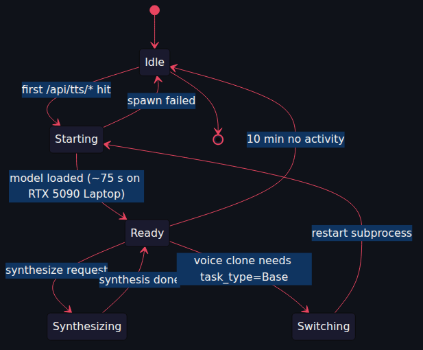
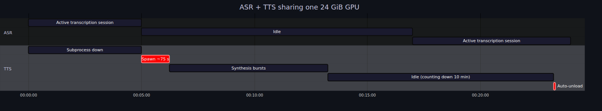
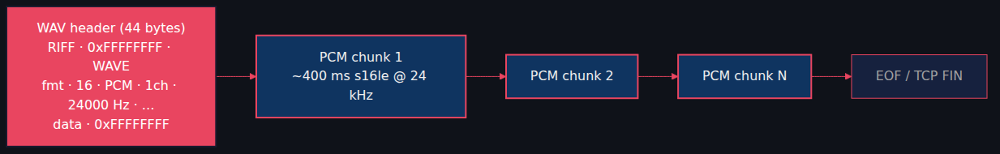
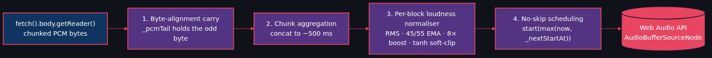

# Voxtral-4B-TTS on vLLM: 20 Voices, Streaming WAV, and a GPU Subprocess That Politely Tags Out

*Part 3 of the Starling series. Text in, audio out. A subprocess that auto-spawns on first request and unloads itself ten minutes later. Four DSP fixes between the model and your speakers.*

---

Posts 1 and 2 went audio → text. Time to go the other way.

[Voxtral-4B-TTS-2603](https://huggingface.co/mistralai/Voxtral-4B-TTS-2603) emits *audio codes* instead of text tokens, paired with a flow-matching autoregressor and a neural codec that turns those codes into 24 kHz waveforms. The runtime is `vllm-omni`, a sibling of vLLM with its own OpenAI-compatible HTTP API. We adopt it, work around two upstream quirks, and bolt on the things you need to actually ship.

▶️ **Demo video** (~150 words of German news synthesised end-to-end): <!-- TODO: YouTube URL -->

The MP4 is at `docs/blog/voxtral-tts-vllm/video.mp4`.

---

## 30,000-foot view

Frontend POSTs `{text, voice, speed}` to `/api/tts/synthesize`. FastAPI checks the lifecycle, brings up the TTS subprocess if needed, proxies to vllm-omni, prepends a streaming WAV header, pipes PCM back. Browser schedules AudioBufferSourceNodes for sample-accurate playback. Three processes, two HTTP boundaries, one fairly involved state machine.

## vllm-omni quirks (the install-order trap)

> **Install `vllm` first. Then `vllm-omni`. Never use `--upgrade`.**

Reverse the order and you get a torch 2.11 ↔ vllm version conflict that's unfriendly to debug. `./init.sh --tts` enforces the order; `check_tts_install.py` verifies torch is in `[2.8, 2.11)`.

Two upstream bugs the route handles:

1. **`response_format=wav` + `stream=true` asserts** on missing sample-rate metadata in the first chunk → use `response_format=pcm` and write our own streaming header.
2. **The HTTP stream sometimes drops the terminal chunk** → treat `RemoteProtocolError` as clean EOF if audio already landed.

The launcher also needs `--tokenizer-mode mistral --config-format mistral --load-format mistral` (Voxtral-4B-TTS ships without `config.json`, only `params.json`) and a stage-configs override (`voxtral_tts.yaml`) to bring `gpu_memory_utilization` down from 0.8 to 0.40 — without that, the model OOMs on a 24 GiB GPU.

## Lifecycle: two models, one GPU

Voxtral-Mini-4B (~9 GB) + Voxtral-4B-TTS (~12 GB) = 21 GB. Fits on a 24 GiB GPU only if they're not both loaded. Solution: small async state machine in `voxtral_server/tts/lifecycle.py`.

- First `/api/tts/*` triggers a subprocess spawn (~75 s on RTX 5090 Laptop).
- Subsequent requests reuse the running subprocess.
- After 10 minutes of no activity, idle-unload triggers and ASR gets the room back.
- Voice cloning needs `--task-type Base` (not `CustomVoice`) → state machine handles the restart transparently.

## The streaming WAV header that lies

You want playback to start the moment the first bytes arrive, but a real WAV header needs the file size up front. Solution: write `0xFFFFFFFF` (max u32) in the size fields. Decoders treat this as "unknown" and play whatever shows up.

Tested in Chrome, Firefox, ffmpeg, VLC, Python's `wave` module. All happy.

## The frontend audio player — four DSP fixes

24 kHz mono PCM in ~400 ms chunks. You'd think "browser plays it" is solved. Reader, it is not.

**1. Byte-alignment carry.** `fetch().body.getReader()` gives you chunks at *network packet boundaries*, not at 16-bit-sample boundaries. Without carrying the residual byte, every odd-byte split shifts samples by one byte and you get crackling noise.

**2. No-skip scheduling.** `AudioBufferSourceNode.start(when)` with `when < currentTime` skips into the buffer (slices samples off the head). Always clamp to `max(now, _nextStartAt)`. A brief gap is far less perceptible than chopped sample heads.

**3. Chunk aggregation.** ~400 ms upstream chunks → ~500 ms blocks before scheduling. 5× fewer source boundaries → fewer resampler-startup transients stacking into a sub-bass tremolo.

**4. Per-block loudness normaliser.** **Voxtral itself emits long sentences ~30 dB quieter than short ones.** Not a bug in the player; the model literally outputs different RMS for different sentence lengths. The fix: per-block RMS, 45/55 EMA-smoothed gain, capped at 8× boost, `tanh` soft-clip at ±0.97. This single fix is the difference between "is the model speaking?" and "oh, clearly".

All four live in `frontend/js/modules/tts-player.js`. State machine (`idle → buffering → playing → paused/ended`) exposed via `window.__ttsPlayerState` for Playwright.

## Long-form + voice cloning (the asterisk)

Long-form uses the same regex sentence splitter as the ASR side (Post 1) in reverse. Anything over 1500 chars soft-splits on the nearest comma. Cap is `tts_max_chars=20000`.

Voice cloning storage works: `POST /api/tts/voices/upload`, audit log, listing, `DELETE`. Voice cloning **synthesis** does not work — the public Voxtral-4B-TTS-2603 checkpoint ships without the codec encoder weights (`audio_tokenizer.input_proj.*`, `audio_tokenizer.encoder_blocks.*`). `POST /api/tts/synthesize` with `voice_ref_id` returns 501 with a clean error. Affects both this server and the Rust port in Post 4 equally.

## Lessons

- **Install order is real.** vllm before vllm-omni. Never `--upgrade`.
- **Streaming WAV with `0xFFFFFFFF` placeholders is a perfectly valid hack.**
- **Per-block loudness normalisation is non-optional for Voxtral.** The 30 dB intra-model swing is real.
- **State machines are how you turn "two models, one GPU" from a math problem into a UX.**
- **Voice cloning is shipped except for the part that needs model weights.** Document the constraint; don't hide it.

## What's next

[Post 4](https://github.com/gjovanov/starling/blob/master/docs/blog/voxtral-tts-burn/blog-post-medium.md) ports the whole thing to native Rust on `burn-server`. 386 BF16 tensors, bit-exact flow-matching, no vllm-omni in the path.

Cheers!
