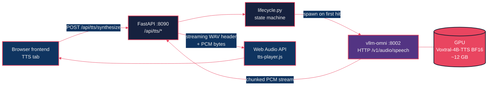
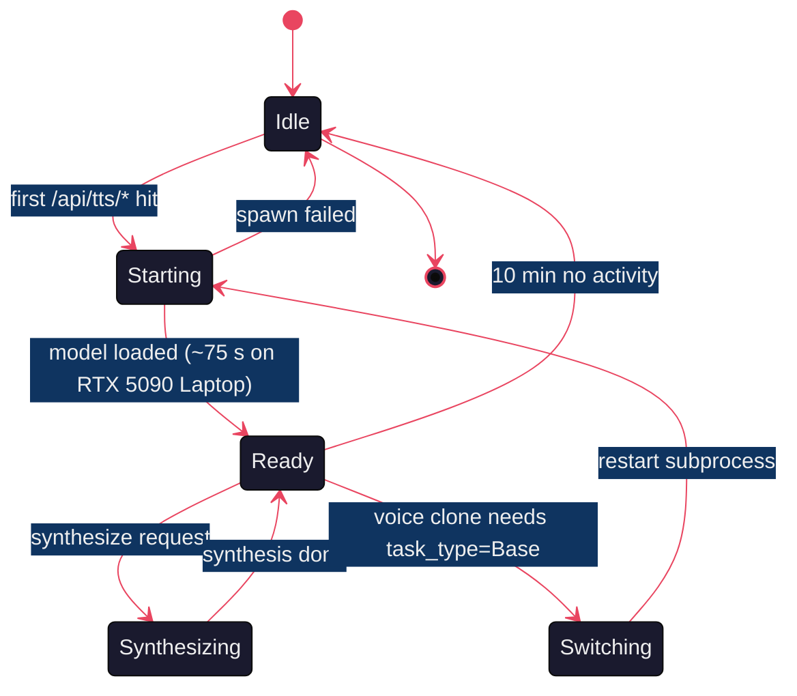
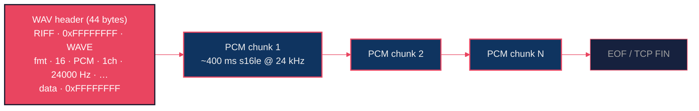

# Voxtral-4B-TTS on vLLM: 20 Voices, Streaming WAV, and a GPU Subprocess That Politely Tags Out

*Part 3 of the Starling series. Text in, audio out. A subprocess that auto-spawns on first request and unloads itself ten minutes later. Four layered DSP fixes between the model and your speakers, including one I was deeply proud of figuring out.*

---

Posts 1 and 2 went audio → text. Time to go the other way.

[Voxtral-4B-TTS-2603](https://huggingface.co/mistralai/Voxtral-4B-TTS-2603) is Mistral's text-to-speech sibling of the Mini ASR model. Same family, very different role: an autoregressive language model that emits *audio codes* instead of text tokens, paired with a flow-matching autoregressor and a neural codec that turns those codes into 24 kHz waveforms.

The runtime story is also different. There's no vLLM realtime API for TTS; the upstream serving runtime is `vllm-omni`, a parallel project that speaks an OpenAI-compatible HTTP API. We adopt it, work around two genuinely-broken upstream quirks, and bolt on the things you need to actually ship: lifecycle management on a memory-constrained GPU, a streaming WAV header that lies about its length, voice cloning storage (with the synthesis half blocked by a missing checkpoint), and a frontend audio player that has more DSP than I initially thought reasonable.

This post is the tour.

---

## Part 1: The 30,000-Foot View



The frontend POSTs `{text, voice, speed}` to `/api/tts/synthesize`. FastAPI checks the lifecycle, brings up the TTS subprocess if it isn't running, proxies to vllm-omni over HTTP, prepends a streaming WAV header, and pipes raw PCM back to the browser. The browser schedules AudioBufferSourceNodes for sample-accurate playback.

Three processes, two HTTP boundaries, one fairly involved state machine.

## Part 2: vllm-omni Quirks (Or: The Install Order Matters)

`vllm-omni` is a separate pip package from `vllm`. Don't ask why; that's just how Mistral's team has chosen to package the multimodal serving stack. The fact that creates a real-life trap:

> **Install `vllm` first. Then install `vllm-omni`. Never use `--upgrade`.**

If you do `pip install vllm-omni` first, it pulls in its own version of vllm and pins torch ≥ 2.11. If you do `pip install --upgrade ...`, you pull torch 2.11 *over* whatever vllm wanted (2.8–2.10), and now vllm doesn't import. The error is unfriendly. The fix is full reinstall.

`apps/vllm-server/init.sh --tts` enforces the correct order, and `scripts/check_tts_install.py` verifies post-install integrity (vllm + vllm-omni + torch in `[2.8, 2.11)`). I recommend you do the same in your project. There are 145 pytest cases and 28 Playwright cases riding on this; a misordered install would silently break all of them.

The launcher itself:

```bash
vllm-omni serve $MODEL_PATH \
    --omni \
    --task-type CustomVoice \           # or Base for voice cloning
    --tokenizer-mode mistral \
    --config-format mistral \
    --load-format mistral \
    --stage-configs-path configs/voxtral_tts.yaml
```

Why all those `mistral` flags? Because Voxtral-4B-TTS ships without a `config.json` — only `params.json`. The `--tokenizer-mode mistral` family teaches vllm-omni to load Mistral's native format.

Why a `stage-configs-path`? Because vllm-omni's default `gpu_memory_utilization: 0.8` OOMs on a 24 GiB GPU. We override to 0.40, with `max_num_seqs: 4` and `max_model_len: 1024` (we never batch more than 1 TTS request at a time, and prompts are short). The override file is `apps/vllm-server/configs/voxtral_tts.yaml`.

**The two upstream quirks the route handles:**

1. **`response_format=wav` + `stream=true` asserts** on missing sample-rate metadata in the first chunk. Workaround: request `response_format=pcm`, prepend our own streaming WAV header (`voxtral_server/tts/wav.py`).
2. **The HTTP chunked stream sometimes drops the terminal chunk** → `httpx.RemoteProtocolError`. The client treats this as clean EOF if any audio bytes already landed (`voxtral_server/tts/client.py::synthesize_stream`).

Neither is fixable upstream without surgery. Both are 5-line workarounds in our code. Onward.

## Part 3: The Lifecycle Manager (or: How TWO Models Live on ONE GPU)

Recall from Post 1: a 24 GiB GPU cannot hold Voxtral-Mini-4B (~9 GB) and Voxtral-4B-TTS (~12 GB) at the same time. Our solution is a small async state machine that brings the TTS subprocess up on the first `/api/tts/*` request and unloads it after 10 minutes of idle.



The state lives in `voxtral_server/tts/lifecycle.py`. Notes worth calling out:

- **Spin-up cost on first request is real**: ~75 seconds on an RTX 5090 Laptop. The frontend shows a spinner and a friendly "Booting TTS engine, this can take a minute" message. We don't try to hide this — it's a real cost.
- **Idle unload**: a background task watches `last_activity` and tears down the subprocess after `BURN_TTS_IDLE_UNLOAD_SECS` (default 600) of nothing happening. The ASR model can then occupy more of the GPU again.
- **Voice cloning needs `--task-type Base` instead of `CustomVoice`** — that requires a full subprocess restart (back to ~75 s). The state machine handles it transparently: `ensure_started(task_type='Base')` triggers a stop + restart if the current task type doesn't match.

If you have a 48 GiB GPU, skip this whole section. The lifecycle becomes "load once, never unload". For everyone else: state machines.

## Part 4: The Streaming WAV Header That Lies

When you `fetch("/api/tts/synthesize")` from the browser and pipe the response into `<audio>` or the Web Audio API, you want a `Content-Type: audio/wav` response that starts playing the moment the first bytes arrive. Problem: a real WAV header includes the total file size. We don't know the total file size, because the model is still synthesising.

The trick: write the header anyway, with `0xFFFFFFFF` (max u32) in the size fields. WAV decoders treat this as "unknown" / "very large", happily decode whatever bytes show up, and stop when the stream closes.



The full 44-byte header is built in `voxtral_server/tts/wav.py::streaming_header(sample_rate, channels, bits)`. We hand it back as the first bytes of the response, then `yield` the PCM as it arrives from vllm-omni. The browser starts playing the moment header + first PCM chunk has arrived — usually ~600 ms after the request.

## Part 5: Long-form Sentence Splitting & Voice Cloning (with the constraint)

Long-form synthesis (a paragraph or a page of text) is one sentence at a time, streamed back-to-back. The frontend joins them seamlessly; the model is fresh on each sentence, which keeps prosody coherent within a sentence and lets us cap total runtime.

The sentence splitter (`voxtral_server/tts/text.py`) is *the same regex* as the ASR sentence splitter from Post 1, used in reverse. It handles `Dr.`, `19. November`, `3.14`, ellipses, German punctuation. Anything over 1500 characters gets soft-split on the nearest comma. The default cap is `tts_max_chars=20000`.

**Voice cloning is the asterisk on this whole post**. Storage works:

- Upload via `POST /api/tts/voices/upload` (multipart) → stored under `voice_refs/<id>/` with an audit log entry.
- List via `GET /api/tts/voices` (mixed with built-ins).
- Delete via `DELETE /api/tts/voices/{ref_id}`.

Synthesis with a cloned voice does *not* work, because the public Voxtral-4B-TTS-2603 checkpoint ships **without the codec encoder weights** (`audio_tokenizer.input_proj.*` + `audio_tokenizer.encoder_blocks.*`). Without those, the reference audio cannot be tokenised, and the upstream's `encode_waveforms()` raises with "encoder weights which are not available in the open-source checkpoint". `POST /api/tts/synthesize` with `voice_ref_id` returns 501 with that message.

This affects both the Python server (this post) and the Rust port (Post 4) equally. To enable cloning, Mistral would need to ship the encoder weights or someone would need to port them.

## Part 6: The Frontend Audio Player (or: Four DSP Fixes I Didn't Plan For)

This is the part I'm proudest of, and the part that has the highest "if you build this you will hit the same problems" value. Voxtral emits 24 kHz mono s16le PCM in ~400 ms chunks. You'd think "browser plays it" is a solved problem.

Reader, it is not.

```mermaid
%%{init: {'theme': 'base', 'themeVariables': {'primaryColor': '#1a1a2e', 'primaryTextColor': '#eee', 'lineColor': '#e94560', 'secondaryColor': '#0f3460'}}}%%
graph LR
    NET["fetch().body.getReader()<br/>chunked PCM bytes"]
    BYTE["1. Byte-alignment carry<br/>_pcmTail holds the odd byte"]
    BLOCK["2. Chunk aggregation<br/>concat to ~500 ms"]
    NORM["3. Per-block loudness normaliser<br/>RMS · 45/55 EMA · 8× boost · tanh soft-clip"]
    SCHED["4. No-skip scheduling<br/>start(max(now, _nextStartAt))"]
    AUDIO[(Web Audio API<br/>AudioBufferSourceNode)]

    NET --> BYTE --> BLOCK --> NORM --> SCHED --> AUDIO

    classDef netStyle fill:#0f3460,stroke:#e94560,stroke-width:2px,color:#eee
    classDef fixStyle fill:#533483,stroke:#e94560,stroke-width:2px,color:#eee
    classDef apiStyle fill:#e94560,stroke:#1a1a2e,stroke-width:2px,color:#fff

    class NET netStyle
    class BYTE,BLOCK,NORM,SCHED fixStyle
    class AUDIO apiStyle
```



**Fix 1 — Byte-alignment carry.** `fetch().body.getReader()` gives you chunks at *network packet boundaries*, not at 16-bit-sample boundaries. So one in two chunks ends mid-sample. If you decode each chunk as `Int16Array(buf)` without aligning, every odd-byte split shifts subsequent samples by one byte and decodes as crackling noise. `_pcmTail` holds the residual byte across chunks. Without this, the demo audibly buzzes; with it, it's clean.

**Fix 2 — No-skip scheduling.** `AudioBufferSourceNode.start(when)` with `when < currentTime` *skips into the buffer*, slicing samples off the head. Always clamp: `start(max(now, _nextStartAt))`. A brief silence gap is far less perceptible than chopped sample heads.

**Fix 3 — Chunk aggregation.** ~400 ms upstream chunks → concatenated into ~500 ms blocks before scheduling. About 5× fewer source boundaries. This reduces resampler-startup transients that would otherwise stack into a sub-bass amplitude tremolo. Same audio bits in, audibly cleaner playback out.

**Fix 4 — Per-block loudness normaliser.** This one cost me a weekend of measurements. **Voxtral itself emits long sentences ~30 dB quieter than short ones.** It's not a bug in the player; the model literally outputs different RMS for different sentence lengths. (The full measurement set is in `apps/vllm-server/docs/tts_spike.md` Phase 8.) The fix:

- Measure RMS per aggregated block.
- Smooth gain with a 45/55 EMA (fast enough to follow real swings, slow enough not to pump on within-sentence dynamics).
- Cap boost at 8× (lower bound 0.125×).
- Soft-clip at ±0.97 with a `tanh` roll-off.

It sounds dry written out. In practice it's the difference between "is the model speaking? I'm not sure" and "oh, it's speaking, clearly".

There's a speed control too — Chrome's `playbackRate` on `AudioBufferSourceNode` is sample-accurate and runs from 0.85× to 1.5× with no glitches. That's just the API doing the right thing. Free of charge.

All four fixes live in `frontend/js/modules/tts-player.js`. There's a small state machine (`idle → buffering → playing → paused/ended`) exposed via `window.__ttsPlayerState` for Playwright assertions — used by the recording spec in `docs/blog/_shared/e2e/record-tts-demo.spec.ts` to know when synthesis has actually finished.

## Part 7: ASR + TTS Coexistence in Motion

A small diagram for what happens over the lifetime of a session that uses both:

```mermaid
%%{init: {'theme': 'base', 'themeVariables': {'primaryColor': '#1a1a2e', 'primaryTextColor': '#eee', 'lineColor': '#e94560', 'secondaryColor': '#0f3460'}}}%%
gantt
    title ASR + TTS sharing one 24 GiB GPU
    dateFormat HH:mm:ss
    axisFormat %H:%M:%S
    section ASR
    Active transcription session                  :a1, 00:00:00, 5m
    Idle                                          :a2, after a1, 12m
    Active transcription session                  :a3, after a2, 7m
    section TTS
    Subprocess down                               :t1, 00:00:00, 5m
    Spawn ~75 s :crit, t2, after a1, 75s
    Synthesis bursts                              :t3, after t2, 7m
    Idle (counting down 10 min)                   :t4, after t3, 10m
    Auto-unload                                   :crit, t5, after t4, 5s
```



The user never sees this state machine directly. They just see: ASR captions show up fast, TTS the first time takes a moment, TTS the second time (within 10 minutes) is fast again, and the GPU has the right amount of room for whatever's happening *right now*.

## Part 8 — Demo

The same ~150-word excerpt of `media/broadcast_1.txt` we used implicitly in Posts 1 & 2 — `Wort zum Thema Ortszentren lädt der ORF…` — synthesised through the full stack: default voice, default speed, streaming WAV, Web Audio playback.

<video src="video.mp4" controls width="100%" muted playsinline></video>

(Notice the playback starts within a second of pressing Generate, before synthesis has finished, and ends right when the model emits its last frame. That's the streaming WAV + the four DSP fixes doing their job in concert.)

---

## Lessons Learned

**1. Install order is real.** vllm before vllm-omni. Never `--upgrade`. Verify with the install-check script. This rule cost me an evening once and zero evenings since.

**2. Streaming WAV with `0xFFFFFFFF` placeholders is a perfectly valid hack.** Every WAV decoder I've tested — Chrome, Firefox, ffmpeg, VLC, the Python `wave` module — handles it. The "real" WAV size you'd compute would never be more correct.

**3. Per-block loudness normalisation is non-optional for Voxtral.** The 30 dB intra-model swing is real. If you ship a player without compensation, your demo will sound like it's whispering half the time.

**4. State machines are how you turn "two models, one GPU" from a math problem into a UX.** The lifecycle manager is 200 lines of Python. It does work that would otherwise require either (a) a second GPU, or (b) restarting the whole server between modes.

**5. Voice cloning is shipped except for the part that needs the model weights.** Storage is full. Audit log is full. Permission gate is server-side enforced. Synthesis returns 501 with a clean error message until Mistral ships the encoder weights. We're documenting this honestly in the API rather than pretending it works.

## What's Next

[Post 4](../voxtral-tts-burn/blog-post.md) is the same model, ported to native Rust on `burn-server`. 386 BF16 tensors, one bit-exact flow-matching autoregressor, a codec built from weight-norm convolutions and ALiBi attention, and absolutely zero vllm-omni in the production path. We'll also revisit the voice-cloning constraint with a dump-tool that tells you up front whether your checkpoint can clone.

Cheers!
